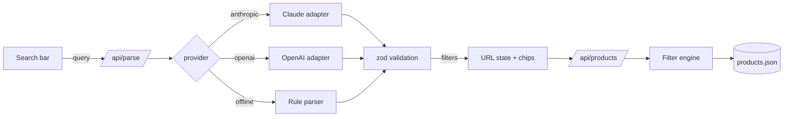

# PRD: shop-search, natural-language product search

Status: draft for review
Shared rules: [STANDARDS.md](STANDARDS.md)

## 1. Overview

Shoppers type what they want in plain English, for example "waterproof women's hiking boots under $150, size 8, 4 stars and up". Keyword search handles this badly. This demo turns that sentence into a validated, editable set of filters over a store catalog and shows the matching products.

It mirrors work Pooya shipped in production: an LLM feature that turns natural-language queries into structured search filters, with validation and an eval suite.

**Portfolio goal:** prove that Pooya can add a reliable AI feature to a real product, not just a chat box. The README and the eval numbers matter as much as the UI.

**Audience:** e-commerce and marketplace founders and agencies (Upwork, Contra) who want "AI search" in their store.

## 2. Goals and non-goals

**Goals**
- Turn a natural-language query into a schema-valid filter object, and show it to the user as editable chips.
- Be honest about the parts of a query that couldn't be mapped.
- Support Claude and OpenAI through one switchable interface, with an offline parser so the demo works without keys.
- Measure parser quality with an eval suite that runs from the command line.
- Feel like a real storefront search: facets, sorting, pagination, and shareable URLs.

**Non-goals**
- Cart, checkout, or accounts.
- Real product images or a CDN.
- A dedicated search engine or vector DB. The README explains how OpenSearch or pgvector would plug in.

## 3. User stories

| # | As a... | I want to... | So that... |
|---|---------|--------------|------------|
| 1 | shopper | type a sentence and see results | I don't have to click through ten filters |
| 2 | shopper | see what the search understood, as chips | I can trust or correct it |
| 3 | shopper | remove or edit a chip | I can refine without retyping |
| 4 | shopper | be told which words weren't understood | I know why results look the way they do |
| 5 | shopper | use normal facets and sorting too | I can browse the usual way |
| 6 | shopper | copy the URL | I can share or bookmark the search |
| 7 | client reviewing the repo | run the eval per provider | I can see accuracy and know it's tested |

## 4. Functional requirements

### 4.1 Catalog
- A deterministic seeded script, `scripts/generate-catalog.ts`, writes `data/products.json` with about 3,000 outdoor-gear products.
- **Fields:**
  - `id`, `title`, `brand`, `category`, `subcategory`
  - `price`, `compareAtPrice` (set when on sale)
  - `rating` (1 to 5), `reviewCount`
  - `gender` (men, women, unisex, kids), `sizes[]`, `colours[]`, `materials[]`
  - `waterproof`, `weightGrams`, `inStock`, `tags[]`, `createdAt`
- **Categories:** footwear, jackets, pants, base layers, backpacks, tents, sleeping bags, accessories.
- Brand names are made up but realistic, and price distributions are plausible for each category.

### 4.2 Filter schema
- One zod schema is the single source of truth. Every field is optional:
  - categories, brands, gender
  - price min/max, minimum rating
  - sizes, colours
  - materials to include and to exclude
  - waterproof, max weight
  - in stock only, on sale only
  - free-text keywords
- The same schema is used to:
  - validate LLM output
  - serialize filters to and from the URL query string
  - drive the filter engine

### 4.3 Parsing
- `POST /api/parse` takes `{ query }` and returns:
  - `filters`: the validated filter object
  - `interpretation`: a short sentence describing what was understood
  - `unmapped`: an array of phrases that couldn't be mapped
  - `provider`: which parser answered
- **Providers** (per the shared standards):
  - Anthropic: `claude-opus-5-5` with low effort, since latency matters for search. Uses structured outputs.
  - OpenAI: `OPENAI_MODEL`, with structured outputs through the zod helper.
  - Offline: regex and keyword rules for price, size, rating, gender, colours, categories, brands, waterproof, and "not X".
- The prompt includes the allowed enum values (categories, brands, colours), so the model can only return values that exist.
- Output that fails validation is never applied. The API returns the offline result and a warning instead.

### 4.4 Search
- `GET /api/products` takes filters from the query string and returns:
  - one page of products
  - the total count
  - facet counts for category, brand, gender, and price buckets
  - which sort was applied
- A pure filter engine module handles filtering, sorting, and pagination:
  - Sorts: relevance (keyword match plus rating), price ascending and descending, rating, newest.
  - 24 products per page.

### 4.5 UI
- **Search bar:** example prompts the user can click, and a submit button that shows a loading state.
- **Chips:**
  - One chip per active filter, in plain words ("Under $150", "Women", "Waterproof").
  - Each chip can be removed, and editing a range opens a small popover.
  - Editing chips re-queries `/api/products` without calling the LLM again.
- **Feedback line:** shows the interpretation and the unmapped phrases ("Couldn't match: 'for my dad'"), plus a small provider badge.
- **Facets:** a sidebar on desktop and a drawer on mobile. Facets and chips stay in sync.
- **Product grid:**
  - Each card shows a generated SVG placeholder by category (no stock photos), title, brand, price with the sale price, rating, and an in-stock label.
  - Results use pagination or "load more".
- **States:** empty results, with a suggestion to relax filters; loading skeleton; errors.
- **URL state:** the query and filters are always reflected in the URL.

### 4.6 Evals
- `evals/cases.json` holds about 30 cases. Each has a query and the expected filters. The set covers:
  - easy cases
  - ranges ("under 1.5k", "between 50 and 80 bucks")
  - unions ("men's or unisex")
  - negation ("not leather")
  - misspellings ("waterprof")
  - colours and sizes
  - unmappable phrases ("for my dad", "as a gift")
- `npm run eval -- --provider=offline|anthropic|openai`:
  - Prints per-field precision and recall, an exact-match rate, a diff for each failed case, and latency.
  - Writes a JSON report to `evals/results/`.

## 5. Non-functional requirements

- Follows the shared quality bar for mobile, accessibility, and dark mode.
- Search results come back from `/api/products` in under 100 ms locally.
- API keys stay on the server. The parse endpoint uses a simple in-memory rate limit, which is enough for a public demo.
- Strict TypeScript, with no `any` in the domain modules.

## 6. Architecture

Key modules: `lib/schema.ts`, `lib/engine.ts`, `lib/parse/{index,anthropic,openai,offline}.ts`, `lib/url.ts`, `app/api/parse/route.ts`, `app/api/products/route.ts`.

## 7. Acceptance criteria

- `npm run lint`, `npm run build`, `npm test` (vitest), and `npm run eval -- --provider=offline` all pass.
- Unit tests cover:
  - the filter engine
  - the schema and URL round-trip
  - the offline parser
  - both LLM adapters, with mocked SDK clients
- Manual flow: type a query, then check that chips and the URL update, results match, removing a chip re-queries without an LLM call, and a shared URL restores the same state.
- Playwright screenshots at desktop and 375px wide are saved to `docs/screenshots/` and used in the README.
- The live LLM paths type-check and follow the docs. They can't run end to end without keys, and the README says so.

## 8. Milestones

1. Schema, catalog generator, filter engine, and tests.
2. Offline parser, evals, and the `/api` routes.
3. UI: search, chips, facets, grid, URL state.
4. Claude and OpenAI adapters, with mocked tests.
5. Polish: screenshots and README.

## 9. Risks

| Risk | Mitigation |
|------|-----------|
| No API keys available locally | Mocked adapter tests plus the offline path; Pooya runs the live eval once keys are added |
| Synthetic catalog feels fake | Realistic brands, titles, price spreads, and sale patterns |
| LLM returns values outside the catalog | Enums in the prompt plus zod validation, with the offline parser as fallback |

## 10. Decisions

- **Live AI:** the public demo uses Claude Haiku 5.5 with caps. When a cap is hit or the provider fails, it falls back to the offline parser. Details are in [STANDARDS.md](STANDARDS.md#public-demos-cost-controls).
- **Cost:** at about $0.0003 per search, 1,000 searches cost roughly $0.30.
- **Limits:** 20 parses per IP per hour, and 1,000 per day globally.
- **Hosting:** Cloudflare Workers. It starts on the free URL and later moves to `shop.pooya.website`.
