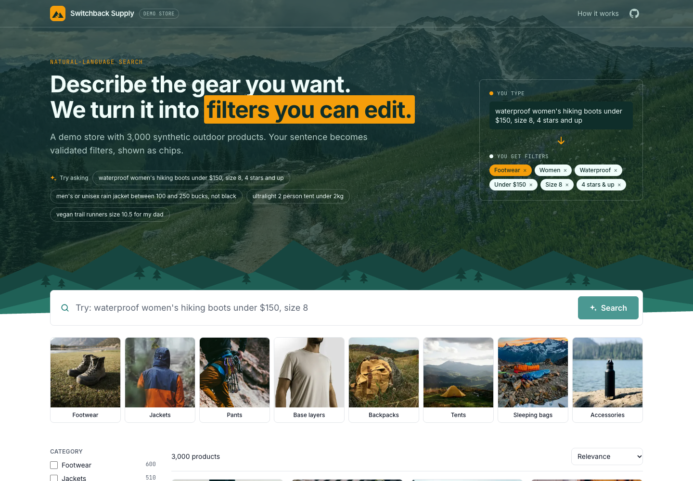
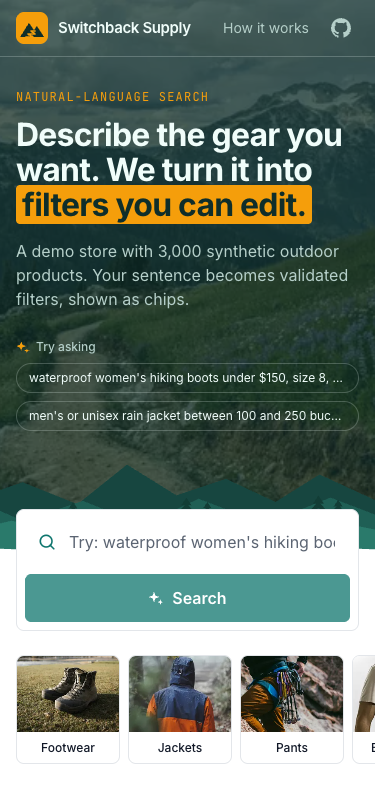
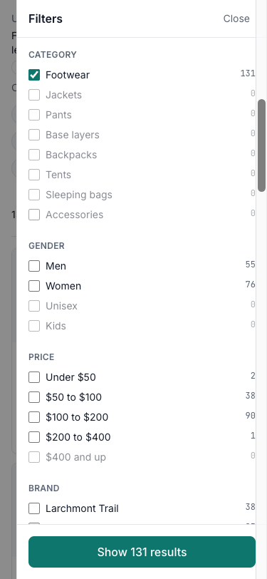
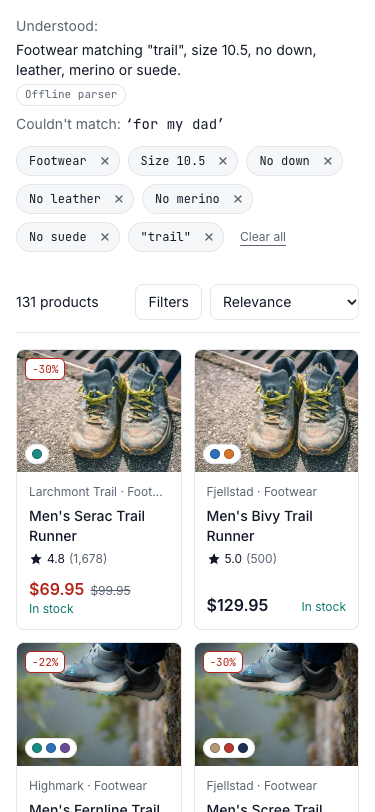
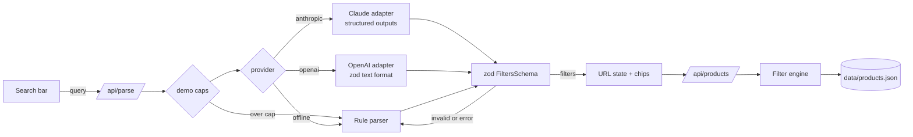

# shop-search

Natural-language product search for an online store. A shopper types "waterproof women's hiking boots under $150, size 8, 4 stars and up" and gets a validated, editable set of filters over a 3,000-product outdoor gear catalog, shown as chips, plus an honest list of the words it could not map. It is built for store owners, marketplaces and agencies who want "AI search" that behaves like a real storefront search: facets, sorting, pagination, shareable URLs, and an eval suite that says how accurate the parser is.

Claude and OpenAI sit behind one small interface. An offline rule-based parser makes the whole app run without keys, and it takes over automatically when a provider fails or a demo cap is hit.

## Screenshots

| Desktop | Mobile (375px) | Mobile filters |
|---|---|---|
|  |  |  |



Product photos are free Unsplash photos, pre-sized to WebP and mapped by subcategory in `config/photos.ts` (picked from a hash of the product id, so the generator and catalog stay deterministic). Subcategories without a matching photo keep the SVG line drawing. Credits: [CREDITS.md](CREDITS.md) and `/credits`.

## Architecture



| Module | Role |
|---|---|
| `lib/schema.ts` | The one zod `FiltersSchema`. Validates LLM output, the URL, and engine input. |
| `lib/url.ts` | Filters and search state to and from the query string. Bad params are dropped one field at a time. |
| `lib/engine.ts` | Pure filtering, relevance and other sorts, 24-per-page pagination, disjunctive facet counts. |
| `lib/parse/offline.ts` | Regex and vocabulary rules: prices and ranges, sizes, ratings, gender unions, colours, brands, negation, typos, weight. |
| `lib/parse/anthropic.ts` | Claude via `messages.parse` with a zod output format, low effort, server-side refusal fallback where the model supports it. |
| `lib/parse/openai.ts` | OpenAI Responses API via `responses.parse` and `zodTextFormat`. |
| `lib/parse/index.ts` | Provider selection, demo caps, validation, and the fallback to offline. |
| `evals/` | 41 cases, per-field precision and recall, exact match, latency, JSON reports. |

## How it works

1. `POST /api/parse { query }` picks a provider (see env vars), checks the demo caps, and asks the model for JSON that matches `LlmOutputSchema`. Every enum (categories, brands, colours, materials, sizes) is listed in the prompt and baked into the schema, so the model can only pick values that exist in the catalog.
2. The answer is validated again with the shared `FiltersSchema`. Output that fails is never applied: the route returns the offline parser's result with a short warning, and the UI shows a small "demo mode" note.
3. The client writes the filters, the original query, the unmapped phrases and the provider into the URL. That URL is the state: reload it or share it and you get the same chips, results and feedback line.
4. `GET /api/products?...` runs the pure engine over the catalog and returns one page, the total, facet counts and the applied sort. Removing a chip, editing a price range or ticking a facet only changes the URL, which re-queries products. The LLM is not called again.

## Evals

```bash
npm run eval -- --provider=offline     # no keys needed
npm run eval -- --provider=anthropic   # needs ANTHROPIC_API_KEY
npm run eval -- --provider=openai      # needs OPENAI_API_KEY and OPENAI_MODEL
```

The runner prints per-field precision and recall, the exact-match rate, a diff for each failed case and latency, then writes `evals/results/<provider>-<timestamp>.json` and `<provider>-latest.json`. It exits non-zero when micro F1 drops below 90% (`--min-f1=0.9`), so it can gate CI.

Offline parser, current run (`evals/results/offline-latest.json`):

| Metric | Result |
|---|---|
| Filter precision (micro, 14 fields) | 99.2% |
| Filter recall (micro) | 98.4% |
| Exact filter match | 39 / 41 (95.1%) |
| Unmapped-phrase recall | 100% |
| Latency p50 / p95 | under 2 ms |

Read these numbers with care. The first 32 cases were written alongside the rule parser, so they show what it handles rather than how it generalises. The 9 `holdout` cases were added afterwards and not tuned for; the two misses are there ("under two hundred" in words, and "don't use leather"). That gap is the honest argument for an LLM parser. The Claude and OpenAI numbers are not in this README because no API keys were available while building; run the commands above once keys are in `.env.local`.

Keywords are free text, so they are reported in the JSON but not scored. Unmapped phrases match when they share a content word ("dad" matches "for my dad").

## Key decisions and trade-offs

- **One schema everywhere.** The same zod object validates model output, parses the URL and types the engine. A separate all-nullable `LlmOutputSchema` exists only because strict structured outputs on both providers want every field present.
- **Fallback, not failure.** Refusals, timeouts, rate limits, bad keys and invalid output all end in the offline parser plus a friendly note, so search never breaks.
- **Claude request shape.** Effort is `low` because this is a latency-sensitive search box. No `temperature`, thinking budget, forced tool choice or prefill, which current models reject. The same request works on `claude-opus-5-5` (local and evals) and `claude-haiku-5-5` (public demo). The server-side refusal fallback (`fallbacks: "default"`) is sent for models that support it and left out for Haiku, which does not.
- **Facets are disjunctive.** Each facet's counts ignore that facet's own selection, so you can see how many results "Men" would add while "Women" is ticked.
- **Keywords are OR, ranked.** A product must match at least one keyword; relevance ranks products that match more keywords first, then by rating weighted by review volume.
- **In-memory data.** 3,000 products filter in a few milliseconds (well under the 100 ms target), so there is no search engine. In production: index the catalog in OpenSearch or Elasticsearch and translate `Filters` into a bool query with `terms`, `range` and `must_not`; or keep Postgres and add pgvector for semantic recall of the free-text keywords, with the structured filters as `WHERE` clauses.
- **In-memory rate limits.** Caps live in the running instance. On Cloudflare Workers every isolate has its own counters, so the real limit is "roughly N per isolate". That is fine as a cost guard backed by a provider spend limit; in production, move the counters to a Durable Object or KV.

What I would do next in production: run the live evals on both providers and track them per release, log unmapped phrases to find vocabulary gaps, cache parses for repeated queries, stream product results while the parse runs, and add analytics on chip removals (a removed chip is a parser mistake signal).

## Run locally

Requires Node 22 (`.nvmrc`); Node 20+ works.

```bash
nvm use
npm install
cp .env.example .env.local   # optional: add keys to use Claude or OpenAI
npm run dev                  # http://localhost:3000
```

Other scripts:

| Command | What it does |
|---|---|
| `npm test` | Vitest: engine, schema and URL round-trip, offline parser, both LLM adapters (mocked SDK clients), rate limiter, eval scoring |
| `npm run lint` | ESLint |
| `npm run build` | Next.js production build |
| `npm run eval -- --provider=offline` | Parser eval |
| `npm run catalog` | Regenerates `data/products.json` (deterministic seed) |
| `npm run preview` | Builds with OpenNext and serves the Worker locally |

Without keys everything runs on the offline parser. The live Claude and OpenAI paths type-check and are covered by tests with mocked SDK clients, but they cannot run end to end until keys are added.

### Environment variables

| Variable | Default | Purpose |
|---|---|---|
| `LLM_PROVIDER` | auto | `anthropic`, `openai` or `offline`. Unset: Anthropic if its key exists, then OpenAI, else offline. |
| `ANTHROPIC_API_KEY` | | Claude key. Server only. |
| `ANTHROPIC_MODEL` | `claude-opus-5-5` | Use `claude-haiku-5-5` for the public demo. |
| `OPENAI_API_KEY` | | OpenAI key. Server only. |
| `OPENAI_MODEL` | none | Required when the provider is `openai`. |
| `DEMO_LIMIT_PER_IP_PER_HOUR` | `20` | LLM parses per IP per hour before switching to offline. |
| `DEMO_LIMIT_GLOBAL_PER_DAY` | `1000` | LLM parses per day (UTC) for the instance. |
| `PARSE_TIMEOUT_MS` | `10000` | Give up on the provider after this long. |

Keys are read only in server route handlers and never sent to the browser.

## Deploy (Cloudflare Workers)

The app ships with OpenNext config (`open-next.config.ts`, `wrangler.jsonc`). Nothing has been deployed yet. `npx opennextjs-cloudflare build` and a local `wrangler dev` smoke test pass.

1. Log in: `npx wrangler login`.
2. Check `wrangler.jsonc`: the worker name, and the `vars` block (`LLM_PROVIDER=anthropic`, `ANTHROPIC_MODEL=claude-haiku-5-5`, the two demo caps).
3. Add the key as a secret: `npx wrangler secret put ANTHROPIC_API_KEY`.
4. Set a monthly spend limit on the Anthropic account. At roughly $0.0003 per search, 1,000 searches cost about $0.30.
5. Preview locally: `npm run preview`.
6. Deploy: `npm run deploy`. The app is served from `shop-search.<account>.workers.dev`.
7. Later, for the custom domain, uncomment the `routes` entry in `wrangler.jsonc` (`shop.pooya.website`, `custom_domain: true`) and deploy again.

## Project layout

```
app/                 page, layout, /api/parse, /api/products
components/          search bar, chips with range popover, facets, grid, product art
config/site.ts       name and links for the footer (placeholders)
data/products.json   generated catalog
evals/               cases, scorer, runner, results
lib/                 schema, engine, url, describe, rate limit, parsers
scripts/             catalog generator
tests/               vitest suites
```
